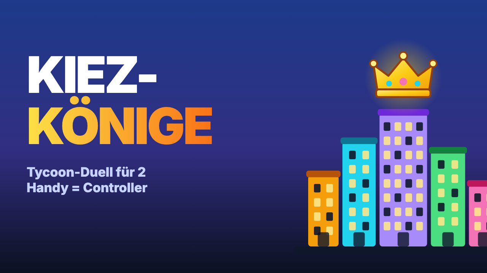
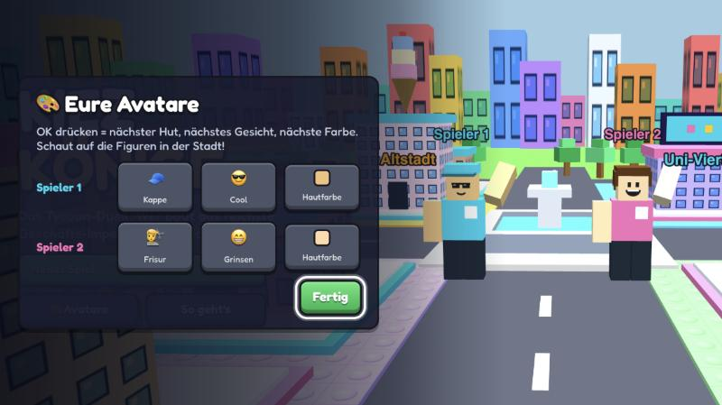
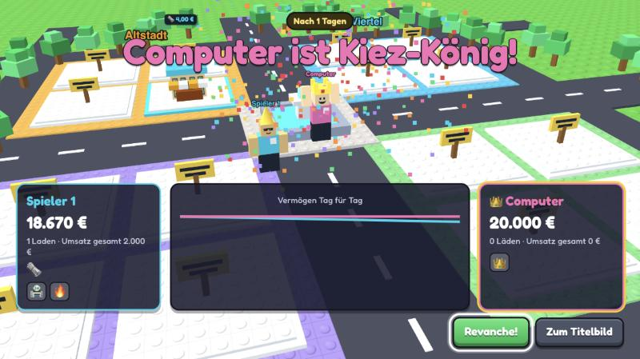
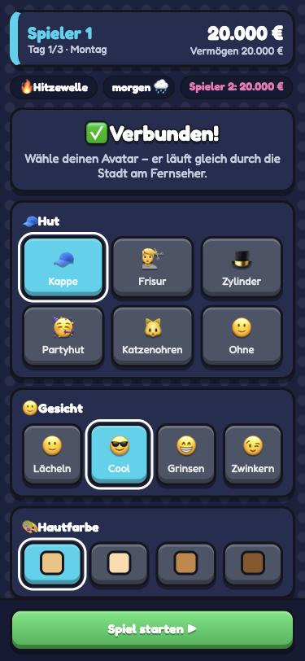

# Kiez-Könige 👑



**Das Tycoon-Duell für den Fire TV:** Zwei Spieler bauen in einer 3D-Stadt (three.js) Läden – Kiosk, Eisdiele, Café, Imbiss, Fitnessstudio, Gaming-Lounge – setzen Preise, bauen aus, machen Werbung, nehmen Kredite auf. Wer nach 10/20/30 Tagen das größte Vermögen hat, ist Kiez-König.

## Installieren

APK herunterladen: **[KiezKoenige-FireTV.apk](https://github.com/chris86tian/kiez-koenige/releases/latest/download/KiezKoenige-FireTV.apk)** und per *Downloader*-App oder `adb install` auf den Fire TV / Android TV spielen.

## Screenshots

| Titel | Avatare | Der Tag läuft |
|---|---|---|
|  |  |  |

| Siegerehrung | Handy-Controller |
|---|---|
|  |  |

## Neu in 2.0

- **Soundtrack mit eigenen Songs** in drei Stilen (im Setup wählbar): ☕ Lo-Fi (warme Septakkorde, Swing, Vinyl-Knistern), 🎵 Chiptune und 🔊 Phonk (Kuhglocken-Riff, 808-Bass). Je ein Song für Morgen-Planung, Verkaufstag und Feierabend – alle selbst komponiert und live mit Web Audio erzeugt
- **Zwei neue Läden:** 👗 Second-Hand-Laden (wie Vinted: günstig einkaufen, mit Gewinn weiterverkaufen) und 🥤 Bubble-Tea-Bar (Liebling im Uni-Viertel, bei Hitze top)
- **Kunden-Bewertungen ⭐ 1–5:** faire Preise und volle Regale bringen gute Sterne – und gute Sterne bringen mehr Kundschaft. Zu teuer oder ausverkauft? Dann sinkt die Bewertung
- **Tagesaufgaben 🎯** für jeden Spieler (z. B. „Verkaufe an 600 Kunden“, „Kein Laden ausverkauft“, „Bring einen Laden auf 4 ⭐“) mit Bonus von 800–1.600 €
- **Abendstimmung:** Fenster und Straßenlaternen leuchten, wenn der Tag zu Ende geht

## Neu in 1.1: Klötzchen-Look

- **Bunte Noppen-Stadt:** Plastikplatten mit Noppen, Klötzchen-Bäume, -Wolken und -Brunnen
- **Block-Figuren:** Die Kundschaft läuft mit schwingenden Armen und Beinen durch die Viertel
- **Eigene Avatare:** Hut, Gesicht und Hautfarbe wählen – am Handy in der Lobby oder am TV unter „🎨 Avatare“. Euer Avatar läuft zum Grundstück, das ihr gerade plant, jubelt bei neuen Läden und trägt am Ende die Krone
- **12 Abzeichen:** Erster Laden, Ladenkette, Ausverkauft!, 1.000 € an einem Tag, Schuldenfrei, Kiez-König …
- **Verbinden leichter gemacht:** kurze Adresse (`IP:8090/1`), größerer QR-Code mit breitem Rand, Adresse groß zum Abtippen

### QR-Code klappt nicht?

1. Handy im **gleichen WLAN** wie der Fire TV (kein Gäste-WLAN, kein mobiles Internet).
2. Kamera-App auf den QR-Code richten und den Link antippen.
3. Alternativ die weiße Adresse unter dem QR-Code im Browser eintippen, z. B. `192.168.1.50:8090/1`.

## Steuerung

| Modus | So geht's |
|---|---|
| 📱 **Handys (gleichzeitig)** | Beide Handys ins gleiche WLAN wie der Fire TV, QR-Code am Fernseher scannen – fertig, keine App nötig. Beide planen gleichzeitig, der Tag startet, wenn beide „Fertig“ tippen. |
| 📺 **Fernbedienung (abwechselnd)** | Eine Fernbedienung, die wird nach jedem Zug weitergereicht. |
| 🤖 **Gegen den Computer** | Spieler 2 = Computer (leicht oder stark). |

## Was man lernt

- **Standort:** Altstadt = Touristen (Eis, Café), Uni = Studis (Imbiss, Gaming), Büropark = unter der Woche voll, Wohngebiet = am Wochenende.
- **Preis vs. Menge:** Zu teuer → Kunden gehen zur Konkurrenz. Zu billig → ausverkauft und Geld verschenkt.
- **Kapazität:** „Ausverkauft“ heißt: ausbauen oder Preis hoch.
- **Kosten:** Ware, Personal, Pacht, Zinsen – der Abendbericht zeigt alles.
- **Wetter & Ereignisse:** Hitze, Regen, Stadtfest, Prüfungswoche, Messe, Influencer …

## Technik

- `game/` – Spiel (three.js r149, reines HTML/JS, 1280×720, D-Pad-Navigation)
- `controller/` – Handy-Controller (Browserseite)
- `android/` – WebView-App mit eingebautem Mini-Webserver (`RelayServer.java`, Port 8090): liefert Spiel und Controller aus und leitet Handy-Befehle weiter (`/api/in`, `/api/state`)
- `tools/devserver.mjs` – gleicher Server in Node zum Testen am Rechner: `node tools/devserver.mjs` → http://localhost:8090/game/
- `tools/balance.js` – Wirtschafts-Simulation zum Ausbalancieren

APK bauen (ohne Gradle, braucht JDK 17 + Android SDK build-tools 34):

```bash
./build_apk.sh            # baut KiezKoenige-FireTV.apk
FIRETV=192.168.x.y:5555 ./build_apk.sh --install
```
